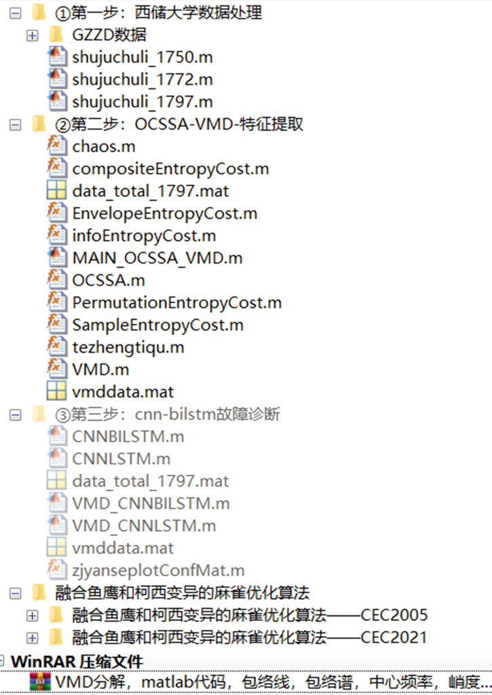
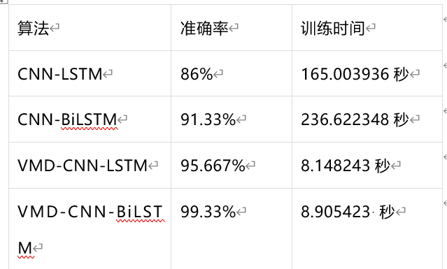
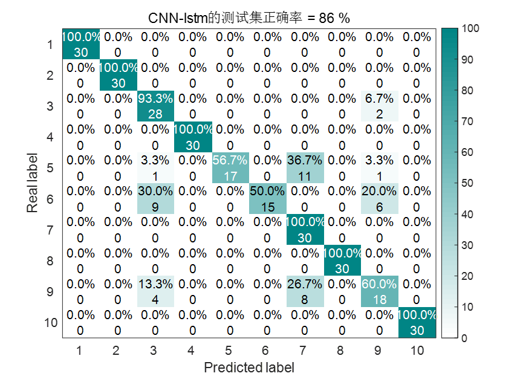
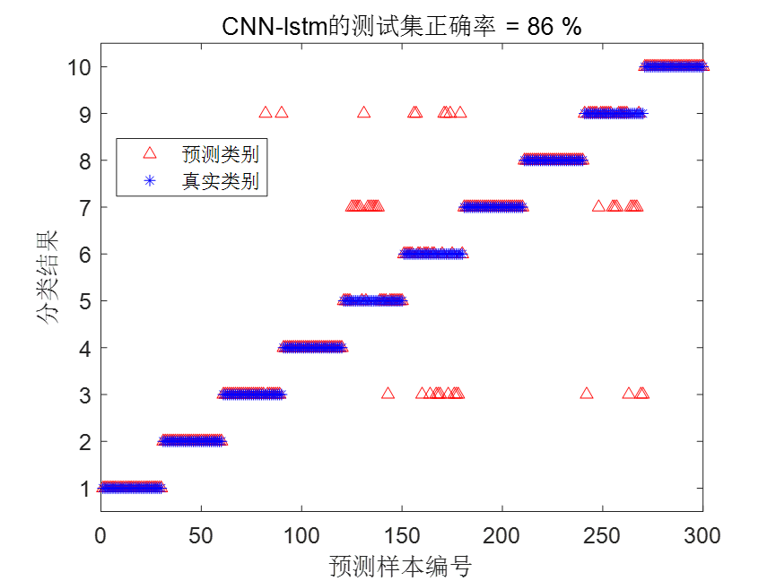
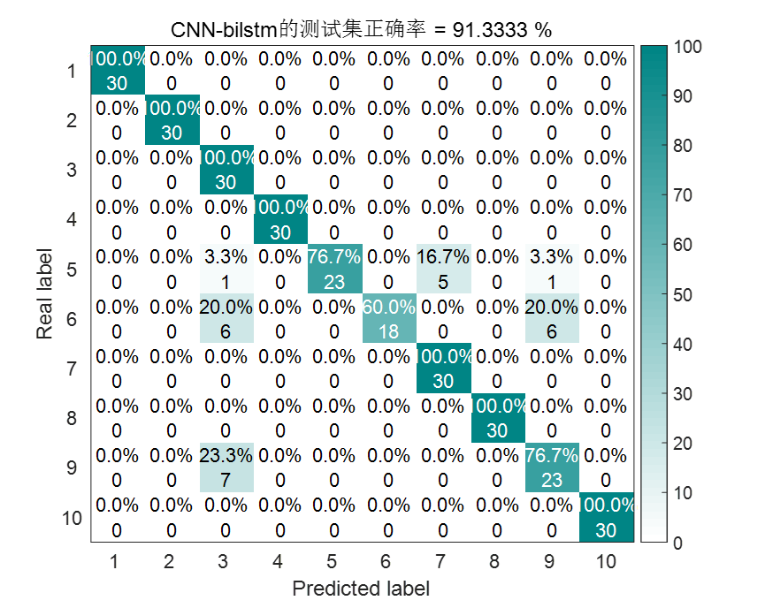
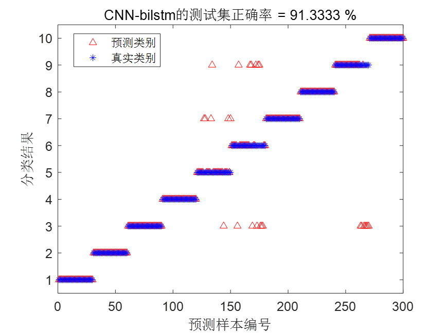
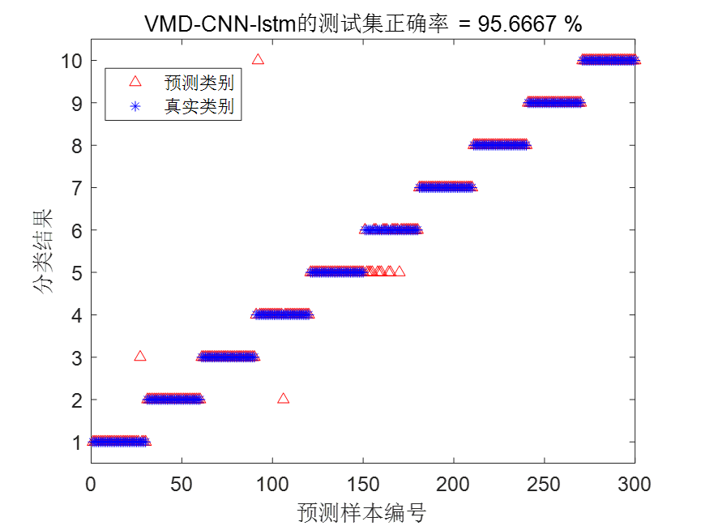
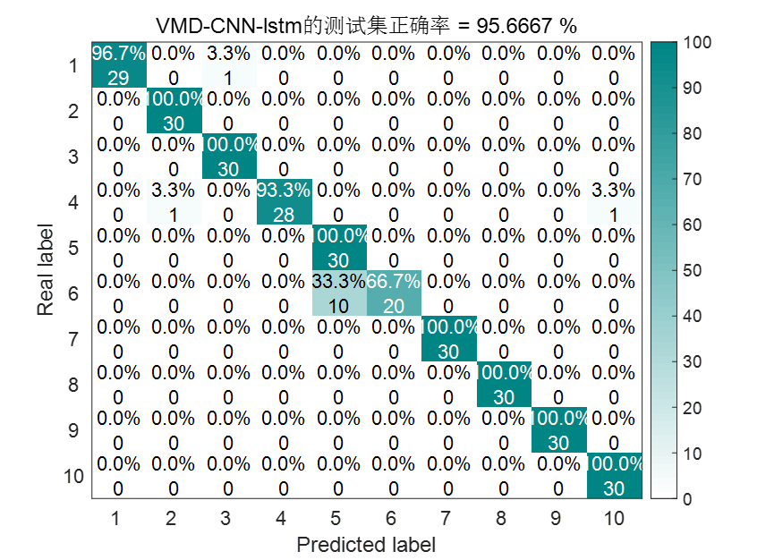
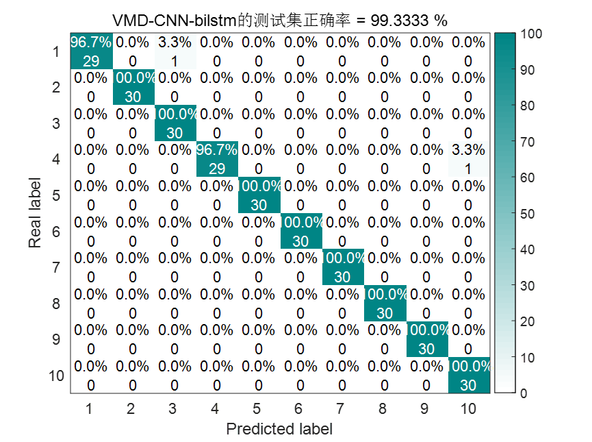
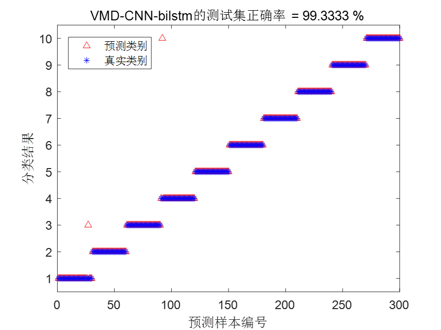

# Nanny-level tutorialsVMD-CNN-BILSTMBearing diagnosis, MATLABCode

This issue brings you the bearing diagnosis using VMD-CNN-BILSTM. 
As in previous issues, it includes data processing, optimization of VMD parameters, feature extraction, and then fault diagnosis with CNN-BiLSTM. Other types of fault diagnosis can refer to this process. Data replacement is very simple! 
In the part of optimizing VMD parameters, a newly launched, highly efficient merged Osprey and Cauchy mutation optimized Squirrel Optimization Algorithm (OCSSA) is used, which also contains code for comparison with other algorithms. 
In the fault diagnosis section, the author has compared four fault diagnosis models: CNN-LSTM, CNN-BiLSTM, VMD-CNN-LSTM, and VMD-CNN-BiLSTM. The superiority of the proposed VMD-CNN-BILSTM model in this issue is highlighted. 
Similar to the previous article, first let's take a look at the folder directory, all carefully organized by the author.
\n        \n  
As shown in the figure, this period involved three tasks:
1. Processing the official downloaded data from Xiuyun University as follows:
a. Load a total of 10 types of data, then select the DE_time (%DE is drive-side data, FE is fan-side data, BA is acceleration data, choose one of them) for each data point.
b. Set the sliding window w, the number of fault sample points s for each data point, and the sample quantity m for each fault type.
c. After all data are slid through the window, integrate them into a single data variable.
For the processing of Xiuyun University's bearing diagnosis data, there was an article previously discussed, which can be referred to: Xiuyun University Bearing Diagnosis Data Processing with MATLAB Free Code.
The numbers 1750, 1772, and 1790 in the figure represent the rotational speeds of Xiuyun University's bearings. When conducting diagnostics, selecting one of these speeds for different faults under the same speed is more meaningful!
2. Perform feature extraction on the data obtained from step 1.
Fans should be aware that there was an article previously published about feature extraction for Xiuyun University's data, but the author was lazy and did not write a large loop. This time, the author has written a large loop for feature extraction, making it convenient to perform one-click feature extraction. You can also easily change your own data!
The specific principle of feature extraction is also detailed in this article. You can jump to read it. In short, it uses the criterion of minimum envelop entropy to extract the best IMF component from each sample, then calculates nine indicators for each sample: mean, variance, peak, kurtosis, effective value, peak factor, pulse factor, waveform factor, and margin factor. These nine indicators are used to construct a feature vector for each sample.
After extracting features, each state has 120 samples, totaling ten states, resulting in a matrix of 1200*9 columns. Then, labels are assigned to each row of data. The first 90 groups in each state are labeled as training sets, while the last 30 groups are labeled as test sets.
III. Implementation of Fault Classification with CNN-BILSTM
The author in this issue compares four fault diagnosis models: CNN-LSTM, CNN-BiLSTM, VMD-CNN-LSTM, and VMD-CNN-BiLSTM.
Results Display
To highlight the superiority of VMD-CNN-BiLSTM, all four models are set to train for 150 times, with a learning rate of 0.01, regularization parameter of 0.001, and begin adjusting the learning rate after training for 100 times, with the learning rate adjustment factor being 0.01. The statistical results are as follows:
\n        \n  
According to the statistical results, the VMD-CNN-BiLSTM diagnostic model not only significantly reduces training time but also achieves the highest diagnostic accuracy.  
CNN-LSTM result graph
\n        \n  
\n        \n  
CNN-BiLSTM results
\n        \n  
\n        \n  
VMD-CNN-LSTM result image
\n        \n  
\n        \n  
VMD-CNN-BiLSTM result image
\n        \n  
\n        \n  
Partial code  
Data processing code:
clc;\nclear;\naddpath(genpath(pwd));\n%DE is the data for the driver end, FE is the data for the fan end, and BA is the data for acceleration. Choose one of them.\nload 97.mat     %Normal\nload 107.mat    % Diameter 0.007 inches, inner ring failure at 1750 RPM\nload 120.mat    % Diameter 0.007, Rolling Bear Fault at Rotational Speed of 1750\nload 132.mat    % Diameter 0.007, outer ring fault at 1750 RPM\nload 171.mat    % Diameter 0.014 inches, inner ring failure at 1750 RPM\nload 187.mat    % Diameter 0.014 inches, rolling element fault at 1750 RPM\nload 199.mat    % Diameter 0.014 inches, outer ring failure at 1750 RPM\nload 211.mat   % Diameter 0.021 inches, inner ring failure at 1750 RPM\nload 224.mat  % Diameter 0.021 inches, rolling element fault at 1750 RPM\nload 236.mat  % Diameter 0.021 inches, outer ring failure at 1750 RPM\nw=1000;                  % w is the size of the sliding window, 1000\ns=2048;                  % Each fault represents 2048 fault points\nm = 10;  % Each type of fault has 120 samples\nD0=[];\nfor i =1:m\n    D0 = [D0,X097_DE_time(1+w*(i-1):w*(i-1)+s)];\nend\nD0 = D0';\nOCSSAOptimizationVMDCode for parameter and feature extraction:   
%% This program takes a very long time to run!\n% vmddata.mat is the final result of feature extraction!\n%% Optimize VMD using OCSSA algorithm to minimize entropies of minimum enclosing set, minimum sample entropy, minimum information entropy, minimum permutation entropy, and arrange entropy/mutual information entropy, aiming for the best two parameters.\nclear\nclc\nclose all\naddpath(genpath(pwd))\nxz = 5;  %xz, select 1, using minimum entropic fitness as the fitness function.\n% Select 2, using the minimum sample entropy as the fitness function.\n% Select 3, using minimal information entropy as the fitness function.\n% Select 4, using the minimum arrangement entropy as the fitness function.\n% Select 5, using the compound index: entropy/mutual information as the fitness function.\nif xz == 1  \n    fobj=@EnvelopeEntropyCost;          % Minimum Entropy\nelseif xz == 2\n    fobj=@SampleEntropyCost;            % Minimum sample entropy\nelseif xz == 3  \n    fobj=@infoEntropyCost;              % Minimum Entropy\nelseif xz == 4\n    fobj=@PermutationEntropyCost;       % Minimum Arrangement Entropy\nelseif xz == 5\n    fobj=@compositeEntropyCost;       % Composite indicator: Arrangement Entropy / Mutual Information Entropy\nend\nload data_total_1797.mat   % Here, we select 10 types of faults with a rotational speed of 1797; you can also choose other types of data.\nD=2;             % Optimize the number of variables\nlb=[100 3];      % Lower limit, which are a, k\nub=[2500 10];        % Upper limit value\nT=20;       % Maximum number of iterations\nN=20;        % Population size\nvmddata = [];\nfor i=1:10   % There are ten fault states\n    disp(['Currently,',num2str(i),'Data for a variety of fault typesVMDOptimization……Please wait patiently.! '])\n    every_data = data(1+120*(i-1):120*i,:);  % A state is 120 samples, select 120 samples for VMD optimization and feature extraction each time.\n    da = every_data(1,:);  % Select a group of data from the current state's data for VMD optimization.\n    [OCSSABest_score,OCSSABest_pos,Bestidx,OCSSA_curve] = OCSSA(N,T,lb,ub,D,fobj,da');\n    display(['1.',num2str(i),'The best data for a specific fault typeVMDParameters are: ', num2str(fix(OCSSABest_pos)),'BestIMFQuantity is: IMF',num2str(Bestidx)]);  % Output the best location\n    %% The following is to bring the best a,k,idx back into VMD and perform 9 time-domain feature extraction.\n    bbh = fix(OCSSABest_pos);% Best position for integer division\n    zuijiazhi(i,:)=[bbh,Bestidx];   % Save the optimal penalty factor, mode component, and index value corresponding to the minimum fitness value of the IMF component in variable zuijiazhi.\n    quxian(i,:)=OCSSA_curve;  % Save the curve of each state optimization VMD optimization in the variable quxian\n    new_data = tezhengtiqu(bbh(1),bbh(2),Bestidx,every_data);  %Bring the optimized two parameters and the index value of minimum fitness back to VMD, extract the feature vector of the current state.\n    vmddata =  [vmddata;new_data];  % Collect all the feature vectors extracted from each state\nend\n    save vmddata.mat vmddata  % Save the extracted feature vectors as mat files\n    save zuijiazhi.mat zuijiazhi  % The first column is the optimal penalty factor, the second column is the optimal mode component, and the third column is the index value corresponding to the IMF component with the minimum fitness value.\n    save quxian.mat quxian  % Each line represents an optimization convergence curve for a state in VMD.\n    %% Remove the path to avoid confusion with other functions\nrmpath(genpath(pwd))\n​\nCNNBILSTMDiagnostic code:   
%% Initialization\nclear\nclose all\nclc\nwarning off\n% Data Reading\naddpath(genpath(pwd));\nload data_total_1797.mat  % Load the preprocessed feature data\n% Data loading\nbv = 120;    % Each state data has 120 groups\n% Add tag value\nhhh = size(data,2);\nfor i=1:size(data,1)/bv\n    data(1+bv*(i-1):bv*i,hhh+1)=i;\nend\ninput=data(:,1:hhh);\noutput =data(:,end);\n​\njg = bv;   % 120 samples per group\ntn = 90;    % Select the first tn samples for training\ninput_train = []; output_train = [];\ninput_test = []; output_test = [];\nfor i = 1:max(data(:,end))\n    input_train=[input_train;input(1+jg*(i-1):jg*(i-1)+tn,:)];\n    output_train=[output_train;output(1+jg*(i-1):jg*(i-1)+tn,:)];\n    input_test=[input_test;input(jg*(i-1)+tn+1:i*jg,:)];\n    output_test=[output_test;output(jg*(i-1)+tn+1:i*jg,:)];\nend\ninput_train = input_train';\ninput_test = input_test';\n% Normalization\n[inputn_train,inputps]=mapminmax(input_train);\n[inputn_test,inputtestps]=mapminmax('apply',input_test,inputps); \noutput_train = categorical(output_train);\noutput_test =  categorical(output_test);\n​\nfor i = 1:size(input_train,2)\n    Train_xNorm{i,:} = reshape(inputn_train(:,i),hhh,1,1);\nend\n​\nfor i = 1:size(input_test,2)\n    Test_xNorm{i,:} = reshape(inputn_test(:,i),hhh,1,1);\nend\n​\nnumFeatures = size(input,2);\nnumHiddens = 120;\nnumClasses = 10;\n  

## Images

<!-- PAYMENT_BLOCK -->

## Get this dataset

- Payment link (Stripe): [Buy now](https://buy.stripe.com/3cs8yP7sY87d0vu9AB)
- Payment QR code: 

<!-- /PAYMENT_BLOCK -->
